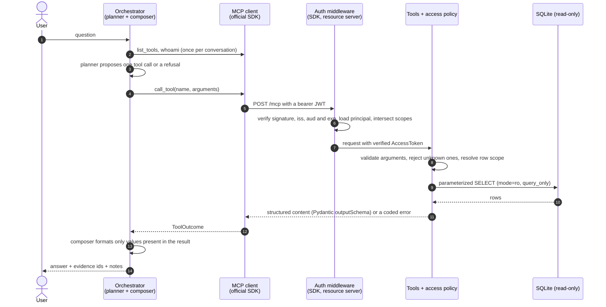

# Architecture

The system has three layers that only talk through MCP: a **server** that owns the data and every access control, a
**client** that speaks the protocol, and an **orchestrator** that turns a question into one tool call and an answer
(its composer also withholds instruction-like memo text; see [security.md](security.md#server-and-client-trust-boundary)).

## Components

| Layer | Module | Responsibility |
| --- | --- | --- |
| Data | `data/generate.py` | Seeded synthetic dataset (fictional company, 40 suppliers, 30 customers, 720 invoices, payments, 5 principals). Atomic write; `dump()` proves reproducibility. |
| Server | `server/app.py` | `LedgerMCPServer` (subclass of the SDK's `MCPServer`), auth settings, `/healthz`, Streamable HTTP app (`json_response=True`, `stateless_http=True`). |
| Server | `server/auth.py` | `TokenIssuer` (demo HS256 JWTs) and `LocalTokenVerifier` (the SDK's `TokenVerifier` interface). |
| Server | `server/access.py` | Scopes, row scope per ledger, business-unit and counterparty checks, tax-id masking. |
| Server | `server/tools.py` | The 8 read-only tools, cursor pagination, controlled errors. |
| Server | `server/repository.py` | Parameterized SQL over a read-only connection; no client SQL path. |
| Client | `client/session.py` | Official `mcp.Client` over `streamable_http_client` with a bearer header; `ToolOutcome` with parsed error codes. |
| Agent | `agent/planner.py` | `Planner` protocol; `DeterministicPlanner` (Demo Mode, rules, no LLM). |
| Agent | `agent/llm.py` | `AnthropicPlanner` (optional LLM Mode; not tested live). |
| Agent | `agent/composer.py` | Deterministic answers from structured results; withholds instruction-like record text. |
| Agent | `agent/orchestrator.py` | Conversation state (identity, last call, next cursor) and `Trace` records. |
| Eval | `evaluation/` | 50 cases, independent SQL oracle, deterministic checks, report writer. |
| Runtime | `runtime.py` | `EmbeddedServer`: the real HTTP server on an ephemeral loopback port, for eval, demo and tests. |

## Design decisions

- **Official SDK, real transport.** The server is the MCP Python SDK v2 `MCPServer`; the client is the SDK's
  `Client` over Streamable HTTP. stdio is not offered because the auth model is HTTP bearer tokens.
- **Stateless JSON responses.** Each POST carries its own token and gets one JSON reply; there is no server-side
  session state to hijack or leak between users.
- **Identity is never an argument.** Tools resolve the caller from the verified `AccessToken`
  (`get_access_token()`), not from parameters. Unknown arguments (for example `subject` or `sql`) are rejected.
- **One tool call per question.** The orchestrator plans a single call, executes it and composes the answer. That
  keeps every answer tied to one auditable tool result. Multi-step plans are on the roadmap.
- **The model never writes the numbers.** In LLM Mode the model only chooses the tool and arguments; the answer
  text is still produced by the deterministic composer from the structured result.
- **Out-of-scope looks like not-found.** A record outside the caller's row scope returns `NOT_FOUND`, so the API
  does not confirm that it exists.

## Demo Mode and LLM Mode

| | Demo Mode (default) | LLM Mode (optional) |
| --- | --- | --- |
| Planner | `DeterministicPlanner`: ordered regular-expression rules | `AnthropicPlanner`: Claude Messages API with the MCP tool schemas as tools |
| Uses a language model | No, and every trace says so | Yes, for tool selection only |
| Answer text | Deterministic composer | Deterministic composer (model text only appears in labelled refusals) |
| Credentials | None | Personal key in the environment (`ANTHROPIC_API_KEY`), never in the repo |
| Status | Implemented and tested | Implemented; unit-tested with a fake client; **not tested against the live API** |

LLM Mode request details: model `claude-opus-5-5` (override `LEDGER_LLM_MODEL`), effort `low` (override
`LEDGER_LLM_EFFORT`), `tool_choice: auto` with parallel tool use disabled. The SDK is an optional extra:
`pip install -e ".[llm]"`.

**Automatic model fallback.** The request opts into Anthropic's server-side refusal fallback
(`fallbacks: "default"`, beta `server-side-fallback-2026-07-01`). If the configured model declines a request on
policy grounds, the API may re-run that same request on another Claude model that the API selects. The provider
never changes (Anthropic only), the fallback applies only to refusals, and the trace does not yet record which
model served the call. To disable it, remove the `betas` and `fallbacks` arguments in `agent/llm.py`. Like the
rest of LLM Mode, this behaviour has not been exercised against the live API.

**Error handling (experimental).** Any exception from the API call (authentication, rate limit, timeout, network)
becomes a labelled `planner_error` refusal, and `max_tokens` stops do too; no tool is called. This path is
checked only with the fake client and has no production validation. The client is created with the SDK's
defaults (its built-in retries for transient errors apply); the planner adds no policy of its own and, once the
SDK gives up, treats every failure the same way. A run with broken credentials therefore shows refusals, not a
crash.

## Data model

`suppliers` and `customers` belong to a business unit; `invoices` carry a ledger (`AP`/`AR`), status, amounts in
cents and an untrusted free-text `memo`; `payments` reference invoices; `principals` hold each fictional user's
allowed scopes, business units and (for supplier-portal users) supplier id. `suppliers.bank_account` exists only to
prove it is never returned. The dataset date is fixed at 2026-06-30 so overdue figures are deterministic.
